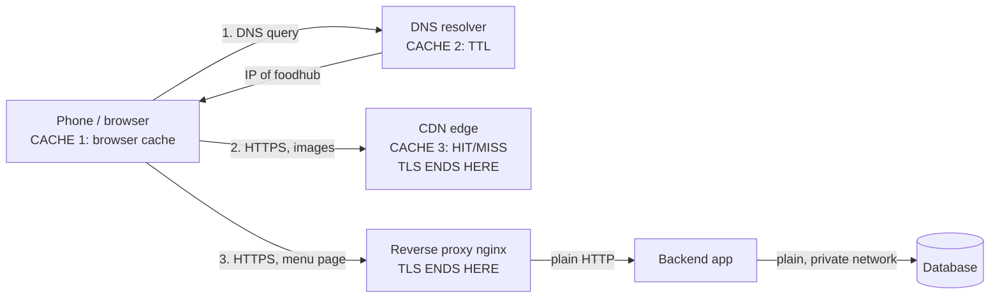

# Week 3 Practice Session: DNS, HTTP and a reverse proxy

Software System Architecture, Semester 1 / 2026-2027

---

## Part A: DNS

| Query | Answer (IP / host) | TTL first run → second run |
|---|---|---|
| www.google.com A | 8 records: 142.251.150.119 to 142.251.157.119 | 300 → 300 (Windows resolver); 13 → 253 (dig @8.8.8.8) |
| www.google.com AAAA | 8 records: 2001:4860:4826:7700:: to 2001:4860:482d:7700:: | 300 → 300 |
| gmail.com MX | gmail-smtp-in.l.google.com (5), alt1 (10), alt2 (20), alt3 (30), alt4 (40) `.gmail-smtp-in.l.google.com` | 395 → 392 (dig @1.1.1.1, 3 s apart) |
| dig +trace rupp.edu.kh: the three levels | 1. Root: `b.root-servers.net` returned the `.kh` name servers. 2. `.kh` TLD: `ns1.dns.net.kh` returned the NS for rupp.edu.kh. 3. Authoritative: `ns1.bluehost.com` / `ns2.bluehost.com` answered **103.67.60.50** (TTL 14400) | n/a |

**Why is the second TTL smaller?**
The TTL is how long a resolver may cache a record. After the first query the resolver stores the answer and counts the TTL down, so a second query returns the cached copy with fewer seconds left. Querying `1.1.1.1` for rupp.edu.kh every 3 seconds gave 13741 → 13738 → 13735 → 13732, so the TTL counted down in real time. Some of my other results went *up* (13 → 253 on 8.8.8.8) because public resolvers are many cache servers behind one anycast IP, and each query can land on a different cache node.

**Domain with several A records and what it is used for:**
`www.google.com` returns 8 A records. This is used for load balancing and redundancy: traffic is spread across several servers, and if one is down the client can use another.

---

## Part B: HTTP and TLS

| Item | What you found |
|---|---|
| IP and port connected to | 172.66.147.243, port 443 (example.com) |
| TLS version | TLSv1.3 (`TLS_AES_128_GCM_SHA256`) |
| HTTP version (example.com / cloudflare h2 / h3) | example.com: HTTP/2 (`ALPN: server accepted h2`), and HTTP/3 200 with `--http3`. cloudflare.com: `--http2` → HTTP/2 200; `--http3` → `http_version=3` (server answered over HTTP/3 with a 103 Early Hints; curl stops there) |
| Status code | 200 OK |
| Three response headers | `server: cloudflare`, `content-type: text/html; charset=utf-8`, `cf-cache-status: HIT` |
| DevTools: requests, total size, TTFB, protocols | khmertimeskh.com: 169 requests, 3.3 MB transferred, TTFB 162.56 ms, protocol h2 |
| CDN check: headers seen, HIT or MISS? | jquery.min.js on cdnjs: `cache-control: public, max-age=30672000, immutable`, `x-cdnjs-cache: HIT`, `Age: 602232` on the second request. **HIT**: the object had been cached for about 7 days. |

---

## Part C: Reverse proxy

| Question | Answer |
|---|---|
| Value of X-Served-By | `foodhub-proxy` |
| Result of `curl localhost:3000`, and why | Fails (could not connect). The `app` service has no `ports:` entry, so port 3000 only exists inside the Docker network. Only the proxy publishes a port (8080:80). |
| Client IP the app sees vs X-Forwarded-For, and why they differ | Log: `GET / from ::ffff:172.18.0.3, X-Forwarded-For: 172.18.0.1`. The app sees 172.18.0.3, the nginx container, because nginx opens its own connection to the app. `X-Forwarded-For` holds 172.18.0.1, the original client as nginx saw it (my host, via the Docker gateway). nginx sets that header so the app can still know who the real caller was. |
| Status code when the app is stopped | **502 Bad Gateway**: nginx is running but its upstream `app:3000` is unreachable. |

---

## Part D: Request-flow diagram

The full diagram is in `week3-request-flow-final.drawio` (A3, draw.io). Text version:

**Where TLS ends:** at the CDN edge (images) and at the reverse proxy (menu page). From the proxy to the backend and database the traffic is plain HTTP inside the private network.

**Where caching happens:** (1) browser cache, (2) DNS resolver cache (TTL), (3) CDN edge cache (HIT/MISS, `Age` header). Optional, not part of this lab: proxy cache and app/database cache.
